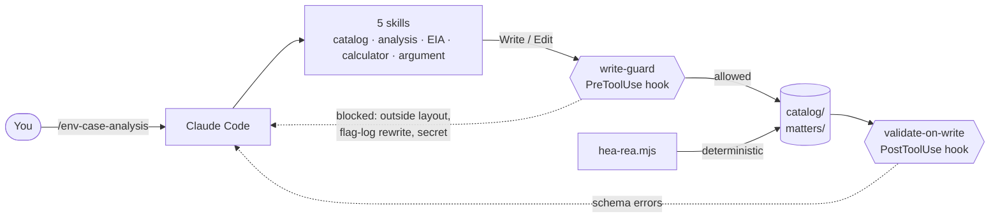

# Aranya

<p align="center">
  <b>An open-source environmental-law agent for India's National Green Tribunal, built as Claude Code skills.</b><br>
  It analyses a matter, reviews an Environmental Impact Assessment, and quantifies restoration-scaled damages with a method that shows its working, citing the exact section, rule or judgment behind every point.
</p>

<p align="center">
  <a href="https://github.com/prathikcannotcode/aranya/actions/workflows/ci.yml"></a>
  <a href="LICENSE"></a>
  
  
  
  
</p>

<p align="center">
  <a href="#quick-start">Quick start</a> ·
  <a href="#what-a-matter-looks-like">Sample output</a> ·
  <a href="#skills">Skills</a> ·
  <a href="#guardrails">Guardrails</a> ·
  <a href="docs/METHODOLOGY.md">Methodology</a> ·
  <a href="#legal-coverage">Coverage</a> ·
  <a href="CONTRIBUTING.md">Contribute</a>
</p>

---

## The gap

The National Green Tribunal can order relief, compensation and **restitution of the environment** (NGT Act 2010, s.15), and must apply the polluter pays principle (s.20). What it often lacks is a transparent way to size the number. Environmental compensation is frequently set ad hoc, and the reasoning behind a figure can be hard to reconstruct.

Resource and Habitat Equivalency Analysis (REA/HEA) is the restoration-scaling method used in United States natural resource damage assessment. Aranya applies it as **persuasive, not binding** analysis that sits inside powers the NGT already has: it measures the ecological service lost to an injury, measures what a restoration project would give back, and solves for the restoration the polluter should fund. Every number is a range an expert signs off, not a black box.

It will not tell you the Tribunal will accept it. It tells you exactly which section, judgment and assumption each step rests on, so a lawyer and an ecologist can check it.

## What a matter looks like

The repo ships with **sample-estuary**, a synthetic matter (a tannery cluster's effluent degrading a 25 ha estuarine wetland), so you can see the format before pointing Aranya at anything of yours. The calculator run is real output you can reproduce; the matter, flags and finding were written by hand:

- [`matter.json`](matters/sample-estuary/matter.json): the matter header, forum set to the NGT
- [`flags.jsonl`](matters/sample-estuary/flags.jsonl): two flagged sections, a statutory provision and an EC condition, append-only
- [`findings/F-0001.json`](matters/sample-estuary/findings/F-0001.json): a finding citing s.15(1)(c) and Schedule II head (g), with its verification state
- [`calc/run-1.json`](matters/sample-estuary/calc/run-1.json): a full REA/HEA run

The calculator's own summary of that run:

```text
HEA equivalency analysis [novel_persuasive, pending_expert_review]
  debit: 117.73 discounted service-hectare-years lost
  restoration: 10.87 to 16.98 ha across the sensitivity range; 13.58 ha at the stated inputs (scaling ratio 0.54)
  cost: INR 54,33,860 to INR 84,90,406; INR 67,92,325 at the stated inputs
  Expert-witness input material, not a final compensation figure...
```

The figures are illustrative and synthetic. The point is the shape: a debit, a restoration scale, a cost, a range, and a status that stays `pending_expert_review` until a named expert validates the inputs.

## How far to trust it

**One scored run.** [Morvali Creek](examples/morvali-creek) is a synthetic matter with 14 planted issues, scored against an answer list committed before the run. The [score](examples/morvali-creek.run-1/SCORE.md): 14 of 14 found, 6 of 6 should-not-flag items left alone, no invented citation. That overstates Aranya: four of the 14 rest on law the catalog doesn't hold, which the run supplied from model memory. The same model wrote the answer list and ran the skills, and no lawyer has reviewed either.

**The catalog has known gaps.** It doesn't yet hold NGT Act s.15(3) or s.16 (the two limitation periods), the EIA 2006 General Condition, para 8(vi) or Appendix IV, or the CPCB compensation method. Its *Vanashakti* note predates the November 2025 recall.

A [source pack](catalog/patches/2026-11-source-pack/README.md) adds 18 entries and corrects 6, each traced to a primary source. It isn't applied yet, because no lawyer has reviewed it; the open points are in [QUESTIONS-FOR-COUNSEL.md](catalog/patches/2026-11-source-pack/QUESTIONS-FOR-COUNSEL.md). Until it lands, treat any point resting on those provisions as unverified. Whether Schedule II head (g) or head (k) carries a restoration-scaled claim is the first of those questions.

## Why Aranya

| | Ad hoc quantum | Consultant's damage report | **Aranya** |
|---|---|---|---|
| Cites the statute or judgment per point | Sometimes | In a PDF | **Every finding; validation rejects one that does not point at a catalog entry** |
| Shows how the number was derived | Rarely | Proprietary model | **A deterministic calculator you can read and re-run, with a sensitivity range** |
| Honest about precedent | Varies | Varies | **Stamps every result `novel_persuasive`; the result schema allows nothing else** |
| Where your matter data goes | — | The firm's systems | **Your machine and your model provider. No Aranya server.** |
| Output | Prose | A report | **Schema-valid JSON and Markdown, in a per-matter workspace** |
| Cost | — | Fees | **Free (Apache 2.0), plus model usage** |

## Quick start

You need [Node.js 22+](https://nodejs.org) and [Claude Code](https://claude.com/claude-code). There is nothing to `npm install`.

1. **Clone and check the workspace.**
   ```bash
   git clone https://github.com/prathikcannotcode/aranya.git
   cd aranya
   npm run validate -- --strict
   ```
2. **See the calculator on the sample inputs.**
   ```bash
   npm run calc examples/sample-injury.json
   ```
3. **Open Claude Code in the repo.**
   ```bash
   claude
   ```
4. **Look at the demo.** Ask *"Walk me through the sample-estuary matter"* or type `/env-catalog jurisdiction`.
5. **Start a matter.** Say *"Analyse this matter: untreated effluent degraded a mangrove stretch; the unit holds an EC."* Aranya checks the forum, applies the statutes, and records findings and flags under `matters/`.
6. **Quantify.** Give the injury and restoration parameters and run `/hea-rea-calculator`; it returns the restoration scale with its range.

## Skills

Every skill is a slash command. You can also describe the task in plain English and Claude picks the right one.

| Command | What it does | Anchored in |
|---|---|---|
| `/env-catalog` | Look up a provision, test NGT jurisdiction, resolve a flagged section, cite a clause with its verification state | `catalog/provisions.json` |
| `/env-case-analysis` | Triage a matter: forum and jurisdiction first, applicable statutes, issues, reliefs, findings | NGT Act s.14, Schedule I |
| `/eia-review` | Review an EIA or Environmental Clearance against the 2006 Notification checklist; flag breached conditions | EIA Notification 2006 |
| `/hea-rea-calculator` | Size restoration against injury in discounted service-years, with a sensitivity range | NGT Act s.15, s.17, Sch. II(g) |
| `/ngt-compensation-argument` | Assemble the restoration-scaled argument: the power, polluter pays, the method, the quantum | NGT Act s.15, s.20; polluter pays |

<details>
<summary><b>Prompts to try, by role</b></summary>

**Advocate**
- *Is this an NGT matter or a writ? The harm is under the Water Act.*
- *Draft the restitution-of-environment prayer and the quantum argument.*
- *Which authority establishes polluter pays in India, and what is the pinpoint?*

**Expert witness**
- *Run HEA for a 25 ha wetland at 70% service loss over a 10-year recovery.*
- *Show me the sensitivity of the restoration scale to the discount rate.*

**Researcher**
- *Summarise the NGT's compensation powers under the Act.*
- *What does Schedule II head (g) cover, and where is it sourced?*

</details>

## How it works



Skills are Markdown that tell Claude what the law provides and how to apply it. Everything Claude writes passes through two hooks, and structured files must match a JSON Schema. The agent can be wrong about the law. It cannot quietly save a finding that does not point at a catalog entry, edit the catalog, rewrite a flag log, mark a result expert-validated, or drop a file outside the workspace. Markdown drafts are not checked for what they claim, so a person has to read them. Hooks don't intercept shell commands; see [SECURITY.md](SECURITY.md).

## Guardrails

| Guard | Enforced by | What it stops |
|---|---|---|
| Workspace layout | `write-guard.mjs` reading [`layout.json`](.claude/schemas/layout.json) | Writes to any path the layout does not list, path traversal out of the repo, and edits to the hooks, schemas and settings themselves |
| Append-only flags | `write-guard.mjs` | Edits to a matter's `flags.jsonl`; a change is a new line |
| Schema validation | `validate-on-write.mjs`, `npm run validate` | A finding with no clause, source or verification state; a result with no `methodology_status` |
| Calculator inputs | `hea-rea.mjs` reading `injury-params.schema.json` | A discount rate of 3 instead of 0.03, a missing input, a mistyped field, injured service above baseline |
| Novel methodology | `calc-result.schema.json` | `methodology_status` can only be `novel_persuasive`; never `established`. This covers results, not Markdown drafts. |
| Expert gate | `write-guard.mjs`, `npm run validate` | An agent recording `expert_validated`, or anyone doing so without `validated_by` and `validated_at`. Nothing confirms the name is genuine, so review the diff. |
| Catalog-only citations | `write-guard.mjs`, `npm run validate` | A finding whose `catalog_id` is not in the catalog or whose source or state differs from it, and any agent edit to the catalog. It can't check that a catalog entry is itself correct, or what a Markdown draft cites. |
| Tests | `npm test`, GitHub Actions | Regressions in all of the above. 28 tests, Node's built-in runner. |

## Methodology

The calculator sets the discounted ecological-service loss of an injury (the debit) against the discounted service gain of a restoration project (the credit), then solves for the restoration scale. HEA scales against habitat service; REA against a specific resource service. Every input is expert judgement, not a lookup, so the output is always a range. The equations, the worked example and the limits are in [docs/METHODOLOGY.md](docs/METHODOLOGY.md).

## Legal coverage

Last verified **4 November 2026**. Entries trace to the Gazette of India, [India Code](https://www.indiacode.nic.in), [environmentclearance.nic.in](https://environmentclearance.nic.in) and the SCC/official reports; see [`catalog/provisions.json`](catalog/provisions.json), where every entry records a `source_url` and a verification state.

| Layer | Covered |
|---|---|
| Instruments | NGT Act 2010, EPA 1986, EIA Notification 2006, Water 1974, Air 1981, Forest 1980, Biodiversity 2002, Wildlife 1972, CRZ 2019 |
| Key provisions | NGT ss.14/15/17/20, Schedule I (seven enactments), Schedule II head (g); EPA s.3; EIA 2006 para 7 stages |
| Doctrines | Polluter pays, precautionary, public trust, sustainable development |
| Leading cases | *Vellore Citizens* (1996) 5 SCC 647; *Indian Council for Enviro-Legal Action* (1996) 3 SCC 212; *M.C. Mehta v. Kamal Nath* (1997) 1 SCC 388 |
| Methodology | HEA and REA, carried as novel persuasive, no Indian precedent |

## What's in the repo

| Path | Purpose |
|---|---|
| `.claude/skills/<name>/SKILL.md` | The five skills |
| `.claude/schemas/` | JSON Schemas and `layout.json`, the list of writable paths |
| `.claude/scripts/` | The write-guard and validate hooks, `lib.mjs`, and `hea-rea.mjs` |
| `catalog/provisions.json` | The source-cited legal catalog |
| `matters/{id}/` | Per-matter workspace: `matter.json`, `flags.jsonl`, `findings/`, `calc/`. Gitignored except the synthetic sample. |
| `docs/` | [METHODOLOGY.md](docs/METHODOLOGY.md) and a [handoff brief](docs/handoff-rea-hea-note.md) for a short paper |

## FAQ

**Is this legal advice?** No. It is tooling that shows its working: every point names its source so a lawyer can check it in minutes rather than rebuild it from scratch.

**Does REA/HEA have Indian precedent?** No documented NGT or Indian court has applied it. Aranya presents it only as persuasive comparative methodology, and the schema forbids claiming otherwise.

**Where do the numbers come from?** A deterministic calculator you can read. Every input is an expert judgement, so the output is a range, validated by an ecologist, never a single authoritative figure.

**Does my matter data leave my machine?** Aranya has no server and no telemetry. Claude Code sends the files it reads to your model provider, as it does on any repo. Your matters are gitignored by default, so a `git add .` in a public fork won't publish a client's file.

**Can I trust the catalog?** Each entry carries a `source_url` and a verification state, and agents can't edit it. Read the entry's `note` as well: some list points still to confirm, such as case pinpoints. Confirm against the primary source before anything goes into a filing; see [CONTRIBUTING.md](CONTRIBUTING.md).

## Contributing

Verified catalog entries, corrected pinpoints, and sector-specific checklists are the most useful contributions. Read [CONTRIBUTING.md](CONTRIBUTING.md), then [AGENTS.md](AGENTS.md), which binds human and AI contributors alike. Report vulnerabilities through [SECURITY.md](SECURITY.md). Changes are listed in [CHANGELOG.md](CHANGELOG.md).

## Disclaimer

Aranya provides tooling and informational structure. It does not constitute legal advice, and it does not produce environmental-impact studies. REA/HEA has no NGT precedent and is offered as persuasive methodology only. For binding decisions, instruct qualified environmental counsel and, for damage quantum, a qualified ecological expert.

## License

[Apache License 2.0](LICENSE).
